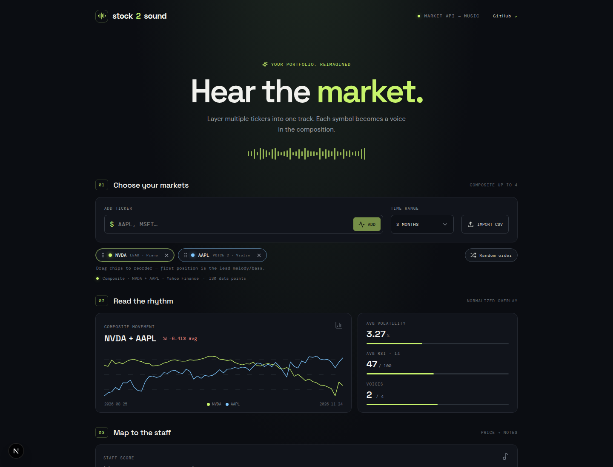
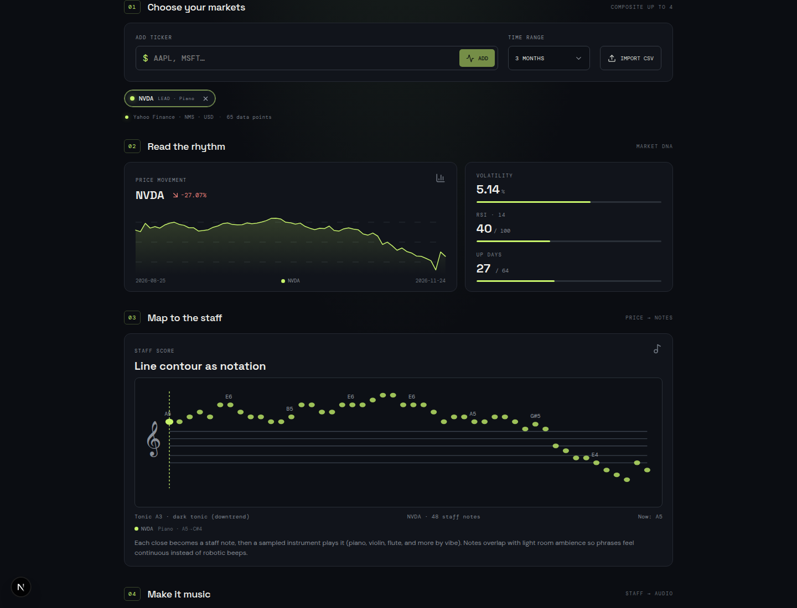
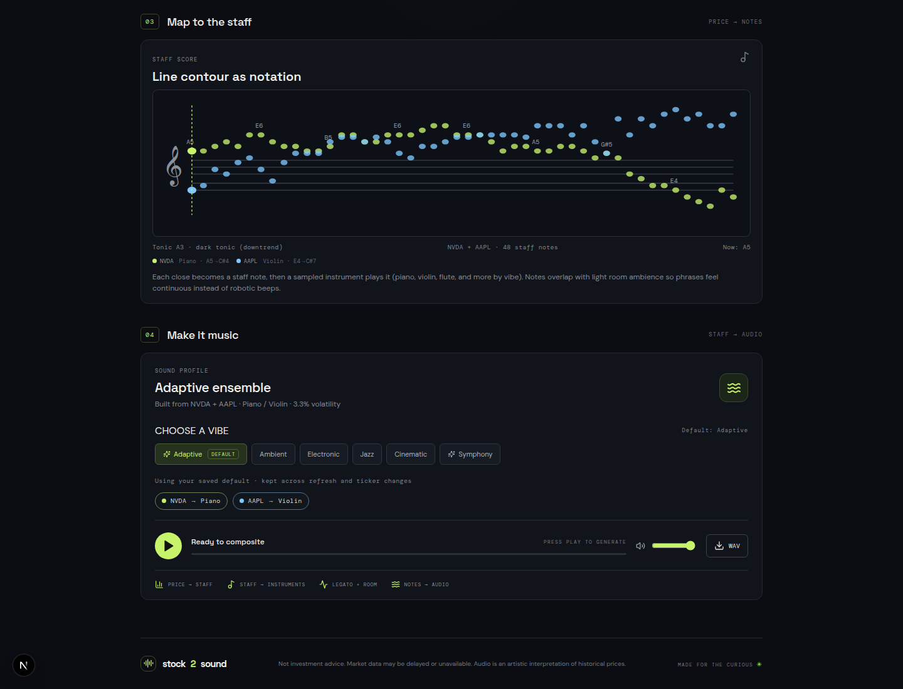

# Stock2Sound

**Hear the market.** Stock2Sound turns historical price movement into generative music — live market data in, a staff score and sampled instruments out.

Layer up to four tickers into one composite track. Each symbol becomes a voice (piano, violin, flute, cello, and more), ordered so the lead drives melody and bass while the others fill harmony.



## Why this exists

Markets already have rhythm: trends climb and fall, volatility tightens and expands, up-days and down-days alternate. Stock2Sound makes that contour audible without treating finance as a dashboard of numbers alone. It is a creative / educational experiment — not investment advice.

## Features

- **Live market data** from Yahoo Finance through same-origin `/api/market` (no hand-fed demo series, no browser CORS fights)
- **Ticker autocomplete** via `/api/ticker-search`, with plain-language errors for missing symbols
- **Time ranges with matching bars:** 1D (5m), 1W (15m), 1M / 3M / 6M / 1Y / 2Y (daily), 5Y (weekly)
- **Multi-ticker composites** — drag chips to set the lead, or hit **Random order**
- **Staff-mapped composition** — prices become named notes on a treble staff before synthesis
- **Sampled instruments** via soundfonts, with legato overlap and light room ambience
- **Vibes:** Adaptive, Ambient, Electronic, Jazz, Cinematic, Symphony — save a default that survives refresh
- **CSV import** fallback (`Date`, `Close`/`Price`, optional `Volume`) and **WAV export**

## Screenshots

### Choose markets & read the rhythm

Add tickers, pick a range, and inspect normalized overlays plus volatility / RSI / voice count.


### Price → staff

Each close is placed on a scale ladder, shown as staff notes (for example `G4`, `A5`) so you can see the contour that will be played.



### Staff → instruments

Pick a vibe, press play, adjust volume, and export a WAV. Live playback uses sampled instruments; WAV export is a lightweight rendered preview.



## How market data becomes music

1. **Fetch closes** for each ticker over the selected range (or parse an imported CSV).
2. **Normalize & score metrics** — return, realized volatility, RSI-14, up-days — to bias tempo, dynamics, and tonic mood.
3. **Map price → staff degree** within each voice’s range (lines & spaces across a few octaves).
4. **Staff → named MIDI notes** rendered on the on-screen score.
5. **Notes → instruments** with soundfont players, legato durations, and a small delay/filter ambience bus.
6. **Composite mix** downscales gains as you add voices so the lead stays clear.

## Run locally

Requires **Node.js 18+**.

```bash
npm install
npm run dev
```

Open [http://127.0.0.1:4537](http://127.0.0.1:4537).

The app auto-loads `NVDA` from `/api/market` on startup. Change the ticker or time range to fetch again. Add more symbols to build a composite.

### Production build

```bash
npm run build
npm start
```

## Project layout

| Path | Role |
| --- | --- |
| `app/components/StockApp.js` | UI, playback, WAV export |
| `app/lib/staffScore.js` | Price → staff → MIDI composition |
| `app/lib/instruments.js` | Soundfont loading & ambience bus |
| `app/lib/marketMath.js` | Volatility, RSI, sampling helpers |
| `app/api/market/route.js` | Yahoo chart proxy |
| `app/api/ticker-search/route.js` | Autocomplete proxy |

## Data & limitations

Yahoo Finance is a third-party service and may change, throttle, or become unavailable. If loading fails, import a CSV instead. No market data is stored on a server beyond short response caching. Audio is an artistic reading of history, not a trading signal.

## License

MIT
